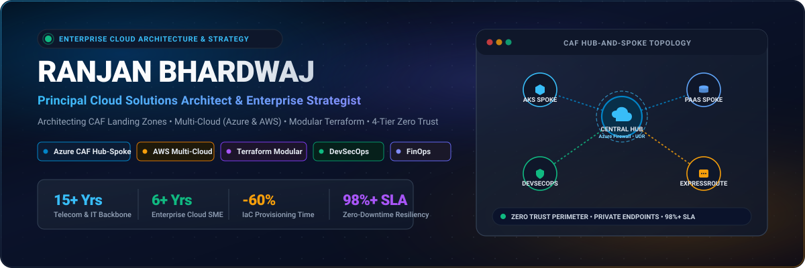
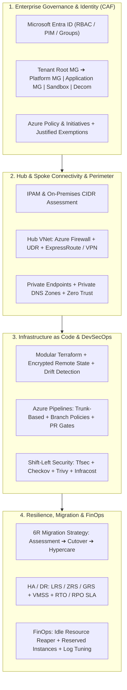

<div align="center">

  <!-- Custom Enterprise Cloud Architect Banner -->
  <a href="https://linkedin.com/in/ranjan-bhardwaj" target="_blank">
    
  </a>

  <!-- Animated Subtitle -->
  <a href="https://linkedin.com/in/ranjan-bhardwaj">
    
  </a>

  <br/><br/>

  <!-- Quick Badges -->
  <a href="https://linkedin.com/in/ranjan-bhardwaj" target="_blank">
    
  </a>
  
  <a href="#-enterprise-architecture-domains--playbooks">
    
  </a>
  <a href="https://linkedin.com/in/ranjan-bhardwaj" target="_blank">
    
  </a>

</div>

---

### 🌟 Executive Summary

**Cloud Solutions Architect & Infrastructure Planning Leader** with **15+ years** of total IT & telecommunications backbone experience, including **6+ years** architecting, automating, and scaling mission-critical enterprise cloud ecosystems (Azure-primary, with hands-on AWS exposure).

* 🏛️ **Cloud SME & Enterprise Architecture**: Trusted technical authority formulating Cloud Adoption Framework (CAF)-aligned Landing Zones, Tenant & Management Group Hierarchies, Subscription Vending, and multi-region HA/DR blueprints.
* ⚙️ **Terraform Landing Zone Engineering**: Architect of reusable, modular Terraform frameworks with remote state hardening, linting, secret scanning, costing, and automated drift detection pipelines — cutting infrastructure provisioning lead times by **60%**.
* 🛡️ **Multi-Tier Zero Trust Security & DevSecOps**: Implemented end-to-end defense-in-depth across Identity, Network, Governance, and Compute levels, embedding **Tfsec**, **Checkov**, and **Trivy** into trunk-based CI/CD pipelines to accelerate release velocity by **40%**.
* 🌐 **Mission-Critical Hub & Spoke Networking**: 15-year telecom and networking foundation designing centralized inspection, UDRs, Azure Firewall, Private Endpoints, ExpressRoute, and IPAM/CIDR conflict resolution.
* 💰 **FinOps & Cloud Modernization**: Championed enterprise cost governance (unattached disk cleanup, VM rightsizing, Reserved Capacity, Log Analytics optimization) and end-to-end 6R migration cycles with zero-downtime cutovers.
* 🤝 **Client, Vendor & GTM Leadership**: Led client architecture workshops, RFP/RFI technical evaluation matrices, SOW drafting, commercial proposals, senior technical interviews, and engineering team upskilling.

---

### 📊 Impact & Value Delivered

<div align="center">

| 🏆 Total Experience | ☁️ Cloud Architecture | ⚡ Provisioning Speed | 🚀 Release Acceleration | 🛡️ Reliability / SLA |
| :---: | :---: | :---: | :---: | :---: |
| **15+ Years**<br>IT & Network Backbone | **6+ Years**<br>Azure & AWS Architecture | **60% Reduction**<br>Modular Terraform | **40% Faster**<br>Automated DevSecOps | **98%+ Sustained**<br>Zero-Downtime HA/DR |

</div>

---

<a id="enterprise-architecture-domains--playbooks"></a>
### 🏛️ Enterprise Architecture Playbooks & Capabilities



---

#### 1. 🏢 Enterprise Governance, Identity & Tenant Hierarchy
* **Microsoft Entra ID (Azure AD)**: Comprehensive user and security group lifecycle management, role-based access control (**RBAC**), least privilege access principles, and Microsoft Defender for Cloud integration.
* **Management Group Hierarchy Architecture**:
  * Designed hierarchical structures beneath **Tenant Root Group**: *Platform MG* (Management, Connectivity, Identity), *Application/Landing Zones MG* (Corp, Online), *Sandbox MG*, and *Decommissioned MG*.
* **Subscription Governance & Boundaries**: Clear separation between platform and workload subscriptions; automated subscription vending, onboarding, and decommissioning workflows.
* **Policy-as-Code & Guardrails**: Enterprise Azure Policy and Policy Initiatives assignments enforcing tags, allowed SKUs, encryption standards, and geographic residency, paired with formal **policy exemption workflows** requiring documented business justifications.

#### 2. 🌐 Hub-and-Spoke Networking Architecture & Zero Trust Perimeter
* **Centralized Traffic Inspection & Egress**: Hub VNet architecture hosting centralized Next-Gen Firewalls (Azure Firewall / NVA) with User Defined Routes (**UDR** / `0.0.0.0/0`) forcing all spoke-to-spoke and spoke-to-internet traffic through inspection.
* **IPAM & CIDR Planning**: Enterprise IP address space design and on-premises CIDR assessment to eliminate IP overlap across hybrid and multi-cloud environments.
* **Private Connectivity**: Comprehensive implementation of **Azure Private Endpoints** and **Private DNS Zones**, disabling public exposure for PaaS data stores (Azure SQL, Storage, Key Vault).
* **Hybrid Backbone**: Enterprise-grade interconnectivity leveraging **Azure ExpressRoute** (with redundant circuits) and high-availability site-to-site **VPN Gateways**.

#### 3. 🛡️ 4-Tier Defense-in-Depth Security Model
* 🔑 **Identity Level**: Microsoft Entra ID Conditional Access, MFA, Privileged Identity Management (PIM), Just-In-Time (JIT) access.
* 🌐 **Networking Level**: Micro-segmentation via NSGs/ASGs, centralized Azure Firewall with threat intelligence, WAF on Application Gateway & Front Door.
* 📋 **Governance Level**: Continuous compliance auditing with Microsoft Defender for Cloud, regulatory compliance dashboards (CIS, ISO 27001), and Azure Policy deny effects.
* 💻 **Compute Level**: Hardened OS baseline images, VM disk encryption at rest with customer-managed keys (CMK), container vulnerability scanning with Trivy.

#### 4. ⚙️ Production Terraform Landing Zone Automation
* **Hardened Remote State**: State stored in dedicated Azure Blob Storage with encryption at rest, TLS 1.2+ enforcement, strict least-privilege RBAC, and lease-based state locking.
* **Modular Enterprise Framework**: Reusable, parameterized Terraform modules versioned in private registries for networking, compute, identity, and PaaS.
* **Automated Quality & Security Gates**: CI/CD integration of `tflint`, `terraform fmt`, `checkov`, `tfsec`, and secret scanning.
* **Cost & Drift Automation**: Pre-deployment cost estimation via **Infracost** with manual approval gates, plus scheduled unattended pipelines for **Terraform Drift Detection**.

#### 5. 🚀 Azure DevSecOps & Enterprise Pipeline Governance
* **Trunk-Based Branching Strategy**: Short-lived feature branches, mandatory Pull Requests (PRs), minimum reviewer enforcement, and **Code Owners** routing.
* **Branch Protection Policies**: `main` branch deletion locks, linear history enforcement, and mandatory build/security check pass criteria.
* **Multi-Stage YAML Pipeline Templates**:
  * `Stage 1: Validate & Test` (Linting, Unit Tests, Static Code Analysis)
  * `Stage 2: Plan & Security Scan` (Tfsec, Checkov, Trivy, Infracost)
  * `Stage 3: Manual Approval Gate` (CAB / Lead Architect sign-off)
  * `Stage 4: Automated Apply` (Isolated service principal deployment)
  * `Stage 5: Rollback & Notification` (Automated failback and telemetry alerting)
* **Middleware & Compute Bootstrapping**: Automated provisioning using VM Custom Data and cloud-init scripts for rapid VM configuration.

#### 6. 🔄 Cloud Migration Lifecycle & Cutover Methodology
* **6R Migration Strategies**: Systematic assessment applying *Rehost, Replatform, Refactor, Repurchase, Retain, or Retire* based on workload complexity and business ROI.
* **Phased Migration Journey**:
  * **Phase 1: Discovery & Assessment**: Dependency mapping, network latency profiling, sizing, and TCO/ROI analysis.
  * **Phase 2: Readiness & Landing Zone**: Substrate preparation, connectivity verification, and governance setup.
  * **Phase 3: Migration Execution**: Pre-migration checklists, pilot testing, and data replication.
  * **Phase 4: Cutover & Go-Live**: Strict cutover window execution, DNS repointing, and rollback readiness.
  * **Phase 5: Post-Migration & Hypercare**: 24/7 hypercare support, telemetry validation, and operational handover.

#### 7. 💰 FinOps & Cloud Cost Optimization
* **Waste Elimination**: Automated discovery and decommission scripts for unattached managed disks, idle load balancers, and orphaned public IPs.
* **Compute Optimization**: Rightsizing oversized compute instances and implementing automated schedule-based VM start/stop routines for non-production environments.
* **Log Ingestion Tuning**: Log Analytics workspace optimization, filtering high-volume verbose tables, and configuring retention policies to curb unnecessary ingestion costs.
* **Capacity Planning**: Formulating strategy for Azure Reserved Virtual Machine Instances (1-yr / 3-yr) and Azure Savings Plans to maximize discount realization.

#### 8. 🔄 High Availability, Backup & Disaster Recovery (HA/DR)
* **Storage Resiliency Tiers**: Strategic selection across **LRS**, **ZRS**, and **GRS / RA-GRS** based on data criticality and compliance requirements.
* **Compute High Availability**: Virtual Machine Scale Sets (**VMSS**) with autoscaling, Availability Zones, and cross-region active-passive / active-active topologies.
* **Business Continuity SLAs**: Explicit **RTO** (Recovery Time Objective) and **RPO** (Recovery Point Objective) architecture design, paired with Azure Site Recovery (ASR) failover drills.

#### 9. 📈 Unified Observability & SRE
* **Full-Stack Monitoring**: Centralized monitoring architecture with **Azure Monitor**, Application Insights, and multi-workspace Log Analytics.
* **Actionable Telemetry**: Custom **Grafana** executive dashboards, Prometheus alerting rules, and automated incident escalation workflows to sustain **98%+ production SLA**.

#### 10. 🤝 Vendor, Presales & Technical Delivery Governance
* **RFP / RFI & Presales Engagement**: Authoring comprehensive technical proposal responses, architecture evaluation matrices, and commercial sizing for enterprise bids.
* **Contractual & SOW Governance**: Defining project scope, deliverables, acceptance criteria, milestone payment sign-offs, sprint backlog dependencies, and risk mitigation registers.
* **Vendor & Third-Party Management**: Environment access provisioning governed by least-privilege principles, vendor escalation matrix design, weekly review cadences, and sprint retrospectives.
* **Transitions & Knowledge Transfer**: Structured documentation handovers, operational runbooks, architecture decision records (ADRs), and formal **RACI matrix** accountability.

#### 11. 👥 Technical Leadership, Mentorship & Hiring
* **Senior Technical Interviewing**: Lead panelist for hiring Senior/Principal Cloud Architects, DevOps Engineers, and SREs.
* **Knowledge Transfer & Upskilling**: Conducted organization-wide KT sessions on Terraform modularization, Azure CAF, and Kubernetes best practices.

---

### 🛠️ Technical Ecosystem & Core Stack

<table>
  <tr>
    <td width="25%"><strong>Cloud Platforms</strong></td>
    <td>
      
      
      
      
      
    </td>
  </tr>
  <tr>
    <td><strong>Infrastructure as Code</strong></td>
    <td>
      
      
      
      
      
      
    </td>
  </tr>
  <tr>
    <td><strong>DevSecOps & CI/CD</strong></td>
    <td>
      
      
      
      
      
      
    </td>
  </tr>
  <tr>
    <td><strong>Containers & Platforms</strong></td>
    <td>
      
      
      
      
      
    </td>
  </tr>
  <tr>
    <td><strong>Networking & Security</strong></td>
    <td>
      
      
      
      
      
      
      
    </td>
  </tr>
  <tr>
    <td><strong>Observability & Governance</strong></td>
    <td>
      
      
      
      
      
      
      
    </td>
  </tr>
</table>

---

### 💼 Career History & Core Architectural Milestones

#### **Senior Technical Lead — DevOps & Cloud Architect** | *Colt Technology Services* &nbsp;&nbsp; `Apr 2023 – Present`
* **Enterprise Cloud Strategy & CAF Modernization**: Cloud SME driving multi-cloud strategy, CAF-aligned Landing Zones, and enterprise data modernization roadmaps across Indian and global stakeholders.
* **Tenant & Subscription Hierarchy**: Designed and implemented multi-tier management group architectures (Tenant Root, Platform, Workloads, Sandboxes) with automated subscription vending.
* **Modular Terraform Standardization**: Formulated enterprise-wide reusable Terraform frameworks, establishing remote state hardening, linting, and drift detection pipelines that reduced provisioning times by **60%**.
* **DevSecOps & Shift-Left Implementation**: Embedded security scanners (**Tfsec**, **Checkov**, **Trivy**) into trunk-based Azure DevOps pipelines, accelerating release velocity by **40%**.
* **Client & Presales Engagement**: Partnered with Sales and GTM teams for customer-facing solution architecture in the Indian market, authoring RFP responses, HLD/LLD technical specifications, and driving C-level workshops.
* **AKS & Cloud Native Platforms**: Standardized containerized workloads on AKS using Helm charts, ingress controllers, and secure Key Vault integration.
* **Sustained High Availability & SRE**: Unified telemetry across Azure Monitor, Log Analytics, and Grafana, sustaining **98%+ production uptime**.

#### **Technical Lead — Cloud Architect** | *Colt Technology Services* &nbsp;&nbsp; `Jan 2020 – Apr 2023`
* Led complex cloud migration initiatives, authoring pre/post checklists, cutover procedures, and hypercare plans.
* Engineered hybrid cloud network solutions with ExpressRoute, VPN Gateways, and Azure App Gateway to ensure business continuity.
* Chaired Change Advisory Board (CAB) reviews and release governance meetings, coordinating multi-disciplinary teams.
* Mentored engineers in Terraform IaC, Azure networking, and Kubernetes platform engineering.

#### **Enterprise Telecom & Network Engineering Foundation** &nbsp;&nbsp; `2011 – 2020`
* *SI Infratel | Airtel UNOC | Spectranet*
* 9+ years managing carrier-grade transmission networks, DWDM, SDH, OSPF/EIGRP/VLAN routing, delivering **99.9% network SLA** compliance and 40% faster fault restoration.

---

### 📈 GitHub Activity & Engineering Metrics

<div align="center">
  
  
</div>

<div align="center">
  
</div>

---

### 🤝 Strategic Value Proposition

```
┌────────────────────────────────────────────────────────────────────────┐
│  ✔ Enterprise Governance, Entra ID & CAF Landing Zone Architecture     │
│  ✔ Scalable Modular Terraform (IaC) with Automated Drift Detection     │
│  ✔ Robust DevSecOps Automation with Shift-Left Security Scanners       │
│  ✔ Zero Trust Hub-and-Spoke Networking & Private Endpoint Topologies   │
│  ✔ 6R Cloud Migration Execution: Discovery, Cutover & Hypercare        │
│  ✔ FinOps Cloud Cost Governance & Capacity Optimization (RI / Savings) │
│  ✔ High-Availability & Disaster Recovery Architectures (98%+ SLA)     │
│  ✔ Client-Facing Presales, RFP/RFI Blueprints & GTM Enablement         │
│  ✔ Vendor SOW Governance, Deliverable Sign-Offs & RACI Accountability  │
│  ✔ Senior Technical Interviews, Team Mentorship & Architectural KT     │
└────────────────────────────────────────────────────────────────────────┘
```

---

### 📬 Connect With Me

Looking for an **Enterprise Cloud Solutions Architect**, a **Principal Cloud Strategist**, or a leader to spearhead your cloud modernization and DevSecOps journey?

<div align="center">

<a href="https://linkedin.com/in/ranjan-bhardwaj" target="_blank">
  
</a>
&nbsp;&nbsp;&nbsp;&nbsp;
<a href="https://github.com/ranjan0404" target="_blank">
  
</a>

<br/><br/>

📍 **Location:** Delhi, India &nbsp;|&nbsp; 🌐 **Open to:** Enterprise Cloud Architecture • Remote & Hybrid Engagements • Leadership Opportunities

</div>

<div align="center">
  
</div>
