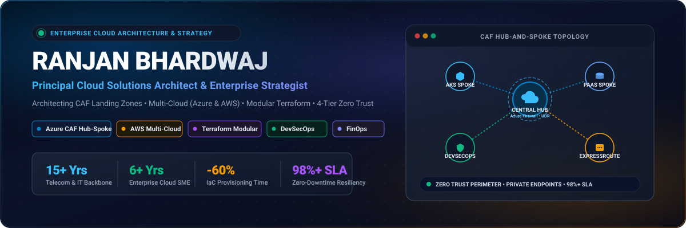
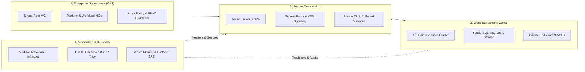
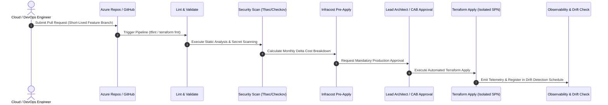

<div align="center">

  <!-- Custom Executive Cloud Architect Banner -->
  <a href="https://linkedin.com/in/ranjan-bhardwaj" target="_blank">
    
  </a>

  <!-- Animated Subtitle -->
  <a href="https://linkedin.com/in/ranjan-bhardwaj">
    
  </a>

  <br/><br/>

  <!-- Quick Action & Status Badges -->
  <a href="https://linkedin.com/in/ranjan-bhardwaj" target="_blank">
    
  </a>
  
  <a href="#-core-architectural-pillars">
    
  </a>
  <a href="https://linkedin.com/in/ranjan-bhardwaj" target="_blank">
    
  </a>

</div>

---

### 🌟 Executive Profile & Strategic Vision

> **Principal / Lead Cloud Solutions Architect** and enterprise infrastructure planning leader with **15+ years** of total IT and telecommunications backbone experience, including **6+ years** architecting, automating, modernizing, and securing mission-critical enterprise cloud ecosystems (Azure-primary, with hands-on AWS exposure).
> 
> Serves as the trusted **Cloud Subject Matter Expert (SME)** across Enterprise Architecture, Cloud Strategy, and Infrastructure Planning. Specializes in translating complex C-level business vision into Cloud Adoption Framework (**CAF**)-aligned Landing Zones, multi-subscription governance guardrails, modular Infrastructure as Code (**Terraform**), and shift-left **DevSecOps** automation.
> 
> Backed by a 9+ year foundation in carrier-grade telecommunications and enterprise optical transport networks (DWDM, SDH, OSPF/EIGRP/VLAN routing), bringing unmatched rigor to multi-region High Availability (**HA**), Disaster Recovery (**DR**), Zero-Trust perimeter networking, and 98%+ SLA production delivery.

<br/>

<div align="center">

| 🏆 Total IT Foundation | ☁️ Cloud Architecture | ⚡ IaC Lead Time Reduction | 🚀 CI/CD Release Acceleration | 🛡️ Uptime & Resiliency SLA |
| :---: | :---: | :---: | :---: | :---: |
| **15+ Years**<br>Telecom & IT Backbone | **6+ Years**<br>Azure & AWS Architecture | **-60% Reduction**<br>Modular Terraform | **+40% Faster**<br>Automated DevSecOps | **98%+ Sustained**<br>Zero-Downtime HA/DR |

</div>

---

<a id="core-architectural-pillars"></a>
### 🏛️ Core Architectural Pillars & Enterprise Capabilities

<table>
  <tr>
    <td width="50%" valign="top">
      <h4>🏛️ 1. Enterprise Governance &amp; CAF Landing Zones</h4>
      <ul>
        <li><strong>Management Group Architecture</strong>: Structured hierarchies beneath <code>Tenant Root Group</code> separating Platform, Workloads, Sandbox, and Decommissioned domains.</li>
        <li><strong>Subscription Vending Automation</strong>: Automated subscription onboarding and boundary isolation across business units.</li>
        <li><strong>Policy-as-Code Guardrails</strong>: Enterprise Azure Policy and Initiatives assignments with formal business-justified exemption lifecycles.</li>
      </ul>
    </td>
    <td width="50%" valign="top">
      <h4>🌐 2. Hub-and-Spoke Networking &amp; Zero Trust</h4>
      <ul>
        <li><strong>Centralized Traffic Inspection</strong>: Dedicated Hub VNet with Azure Firewall / NVA and <code>UDR (0.0.0.0/0)</code> forcing all spoke traffic through inspection.</li>
        <li><strong>IPAM &amp; CIDR Allocation</strong>: Enterprise address space planning and on-premises CIDR assessments avoiding hybrid routing collisions.</li>
        <li><strong>Private Endpoints &amp; DNS</strong>: Complete elimination of public IPs for PaaS services (SQL, Storage, Key Vault) via Azure Private Endpoints.</li>
      </ul>
    </td>
  </tr>
  <tr>
    <td valign="top">
      <h4>⚙️ 3. Production Terraform (IaC) Engineering</h4>
      <ul>
        <li><strong>State Hardening</strong>: Azure Blob storage remote state with encryption at rest, TLS 1.2+, lease locking, and least-privilege RBAC.</li>
        <li><strong>Modular Frameworks</strong>: Enterprise-wide reusable, versioned modules reducing infrastructure spin-up times by <strong>60%</strong>.</li>
        <li><strong>Automated Drift Detection</strong>: Scheduled unattended CI/CD pipelines detecting configuration drift and verifying infrastructure parity.</li>
      </ul>
    </td>
    <td valign="top">
      <h4>🛡️ 4. 4-Tier Defense-in-Depth &amp; DevSecOps</h4>
      <ul>
        <li><strong>Zero-Trust Architecture</strong>: Security controls implemented across Identity, Network, Governance, and Compute layers.</li>
        <li><strong>Shift-Left Static Analysis</strong>: Automated gates using <code>Tfsec</code>, <code>Checkov</code>, and <code>Trivy</code> preventing security misconfigurations in CI/CD.</li>
        <li><strong>Trunk-Based Branching</strong>: Mandatory PRs, minimum 2 peer reviewers, and Code Owners protection on production branches.</li>
      </ul>
    </td>
  </tr>
  <tr>
    <td valign="top">
      <h4>🔄 5. 6R Cloud Migration &amp; Cutover Strategy</h4>
      <ul>
        <li><strong>End-to-End Migration Framework</strong>: Discovery, Readiness, Landing Zone Substrate, Execution, Cutover, and 24/7 Hypercare.</li>
        <li><strong>6R Strategy Formulation</strong>: Tailored application of Rehost, Replatform, and Refactor models based on ROI and dependency profiling.</li>
        <li><strong>Zero-Downtime Cutovers</strong>: Rigorous pre-, during-, and post-cutover runbooks guaranteeing zero business disruption.</li>
      </ul>
    </td>
    <td valign="top">
      <h4>💰 6. FinOps &amp; Cloud Economics</h4>
      <ul>
        <li><strong>Continuous Waste Elimination</strong>: Automated identification and cleanup of unattached disks, idle load balancers, and orphaned IPs.</li>
        <li><strong>Commitment-Based Sizing</strong>: Strategic utilization of 1-yr / 3-yr Azure Reserved Instances (RIs) and Savings Plans.</li>
        <li><strong>Telemetry Cost Optimization</strong>: Log Analytics ingestion rate tuning, high-volume verbose table filtering, and retention sizing.</li>
      </ul>
    </td>
  </tr>
</table>

---

### 📐 Enterprise Architectural Blueprints

#### 1. CAF Landing Zone & Hub-and-Spoke Connectivity Topology



#### 2. Enterprise DevSecOps CI/CD Multi-Stage Pipeline Lifecycle



---

### 📂 Comprehensive Architectural Playbooks & Enterprise Frameworks

<details>
<summary><b>🏢 Playbook 1: Enterprise Governance, Identity &amp; Tenant Hierarchy (CAF)</b></summary>
<br/>

* **Microsoft Entra ID (Azure AD) Administration**:
  * Formulated role-based access control (**RBAC**) directory architecture following least-privilege principles.
  * Configured Privileged Identity Management (**PIM**) with time-bound Just-In-Time (**JIT**) access, approval workflows, and mandatory MFA.
  * Integrated Microsoft Defender for Cloud for continuous security posture management and regulatory compliance benchmarking (CIS Azure, ISO 27001).
* **Multi-Tier Management Group Hierarchy Architecture**:
  * Architected hierarchical structure beneath the **Tenant Root Group**:
    * **Platform Management Group**: Housing dedicated subscriptions for *Connectivity* (Hub VNets, Firewalls, ExpressRoute), *Management* (Log Analytics workspaces, Azure Automation), and *Identity* (Domain controllers, Entra Connect).
    * **Landing Zones (Workloads) Management Group**: Subdivided into *Corporate* (internal private workloads) and *Online* (public-facing / DMZ workloads).
    * **Sandbox Management Group**: Isolated playground environment with aggressive spend caps and automated daily resource purges.
    * **Decommissioned Management Group**: Holding ground for resources pending formal legal and regulatory archival.
* **Subscription Boundary & Vending Governance**:
  * Established subscription vending automation decoupling core platform governance from application teams.
  * Defined clear boundaries preventing blast-radius expansion across production, staging, and development environments.
* **Policy-as-Code & Initiative Assignments**:
  * Deployed enterprise-wide Azure Policies enforcing mandatory resource tagging, allowed deployment regions, restricted VM SKUs, and customer-managed key (CMK) disk encryption.
  * Formulated strict **Policy Exemption Lifecycles** requiring formal business justification, architectural risk review, and automated expiration dates.

</details>

<details>
<summary><b>🌐 Playbook 2: Hub-and-Spoke Networking Architecture &amp; Zero Trust Perimeter</b></summary>
<br/>

* **Centralized Traffic Inspection & Routing**:
  * Designed central Hub Virtual Network architecture hosting Next-Generation Firewalls (Azure Firewall Premium / Fortinet NVA).
  * Implemented User Defined Routes (**UDR** / `0.0.0.0/0`) across all spoke subnets, forcing spoke-to-spoke, spoke-to-on-premises, and spoke-to-internet traffic through centralized inspection.
  * Configured Application Gateway with Web Application Firewall (**WAF v2**) and Azure Front Door for layer 7 protection and SSL offloading.
* **Enterprise IPAM & CIDR Strategy**:
  * Conducted on-premises and data center CIDR assessments across legacy subnets to prevent IP conflicts.
  * Established systematic IP Address Management (**IPAM**) allocations reserving non-overlapping RFC 1918 blocks for enterprise cloud expansions.
* **Private Endpoint & DNS Architecture**:
  * Implemented Azure Private Endpoints across all PaaS components (Azure SQL Database, Storage Accounts, Key Vaults, Event Hubs), completely disabling public internet exposure.
  * Engineered private DNS resolution across spoke VNets utilizing Azure Private DNS Zones linked to the central Hub with automated forwarders.
* **Hybrid Interconnectivity**:
  * Architected enterprise **Azure ExpressRoute** connectivity with dual redundant circuits across diverse physical locations.
  * Deployed active-active site-to-site **VPN Gateways** (IPsec/IKEv2) as redundant failover paths, sustaining 99.9% network availability.

</details>

<details>
<summary><b>⚙️ Playbook 3: Production-Grade Terraform Landing Zone Engineering &amp; IaC Best Practices</b></summary>
<br/>

* **Hardened Remote State Backend**:
  * Managed Terraform state files in dedicated Azure Storage accounts configured with encryption at rest (CMK), TLS 1.2+ minimum, soft delete, and blob versioning.
  * Implemented strict RBAC granting state read/write access exclusively to CI/CD service principals, coupled with lease-based state locking.
* **Modular Enterprise Framework**:
  * Developed reusable, parameterized Terraform modules versioned via Git tags and hosted in private module registries.
  * Standardized module interfaces with strict variable validation rules, typed variables, and structured outputs for network, compute, and PaaS.
* **Pre-Deployment Static Analysis & Security Gates**:
  * Integrated `tflint`, `terraform fmt`, and static code linters into pre-commit and pipeline validation stages.
  * Embedded **Tfsec** and **Checkov** to enforce policy-as-code and catch Infrastructure as Code misconfigurations prior to plan creation.
* **Automated Cost Estimation & Drift Detection**:
  * Automated pre-apply infrastructure cost deltas using **Infracost** pull request comments, providing visibility before provisioning.
  * Scheduled unattended weekly CI/CD pipelines executing `terraform plan -detailed-exitcode` to detect and alert on unauthorized manual drift.

</details>

<details>
<summary><b>🚀 Playbook 4: Enterprise Azure DevSecOps CI/CD Pipelines &amp; Branching Governance</b></summary>
<br/>

* **Branching Strategy & Protection Policies**:
  * Established a **Trunk-Based Development** model with short-lived feature branches (`feature/*`, `bugfix/*`).
  * Enforced branch protection policies on `main`: locked against direct pushes, disabled branch deletion, and required linear commit histories.
  * Mandated Pull Requests requiring a minimum of two senior peer reviews and automated code owner approval routing based on modified directory paths.
* **Multi-Stage YAML Pipeline Lifecycle**:
  * **Stage 1 (Lint & Validate)**: Execution of syntax checks, `terraform validate`, `tflint`, and ShellCheck on custom bootstrap scripts.
  * **Stage 2 (Security & Compliance Scan)**: Containerized vulnerability scanning with **Trivy**, static IaC security validation with **Checkov** and **Tfsec**, and automated secret scanning.
  * **Stage 3 (Plan & Costing)**: Execution of `terraform plan`, generating encrypted plan artifacts and posting Infracost estimates to the PR.
  * **Stage 4 (Manual Approval Gate)**: Automated notification to Lead Architect / Change Advisory Board (CAB) for production release sign-off.
  * **Stage 5 (Apply & Smoke Tests)**: Automated deployment using dedicated service connections with least-privilege scoping, followed by post-deployment automated health probes.
  * **Stage 6 (Automated Rollback)**: Scripted fallback mechanisms and rollback plan artifacts preserving previous release state in case of deployment failure.
* **Middleware & Compute Bootstrapping**:
  * Automated OS-level provisioning using VM Custom Data and cloud-init scripts, eliminating manual post-provisioning configuration steps.

</details>

<details>
<summary><b>🔄 Playbook 5: Enterprise Cloud Migration Methodology (6R Framework)</b></summary>
<br/>

* **6R Strategy Formulation**:
  * Systematically evaluated application portfolios applying the 6R methodology:
    * **Rehost (Lift & Shift)**: Rapid migration of legacy servers using Azure Migrate with minimal architecture modification.
    * **Replatform**: Migration to managed services (Azure SQL Managed Instances, Azure App Services) reducing operational overhead.
    * **Refactor / Re-architect**: Modernizing monolithic applications into microservices deployed on Azure Kubernetes Service (AKS).
    * **Repurchase**: Transitioning custom CRM/mail tools to commercial SaaS solutions.
    * **Retain**: Keeping high-security or latency-bound workloads on-premises pending network modernization.
    * **Retire**: Decommissioning redundant applications, yielding immediate software licensing savings.
* **Phased Migration Journey**:
  * **Phase 1: Discovery & Assessment**: Automated dependency mapping, utilization profiling, sizing validation, and TCO/ROI business case generation.
  * **Phase 2: Landing Zone Substrate Readiness**: Network peering, hybrid routing, security perimeter, and identity federation validation.
  * **Phase 3: Migration Execution & Pilot Waves**: Non-production wave execution, continuous data replication via Azure Site Recovery (ASR), and network latency testing.
  * **Phase 4: Cutover Window Execution**: Strict maintenance window scheduling, data synchronization validation, DNS repointing, and rollback readiness testing.
  * **Phase 5: Post-Migration & Hypercare**: 24/7 hypercare support team leadership, performance telemetry verification, and operational runbook handover to SRE teams.

</details>

<details>
<summary><b>💰 Playbook 6: FinOps, Cloud Economics &amp; Continuous Cost Governance</b></summary>
<br/>

* **Proactive Waste Elimination**:
  * Developed automated PowerShell and Azure CLI scripts to identify and decommission unattached managed disks, orphaned public IPs, and unused virtual network gateways.
  * Configured Azure Advisor cost alerts and automated tagging policies attributing 100% of cloud spend to specific cost centers.
* **Compute Right-Sizing & Scheduling**:
  * Analyzed CPU, memory, and disk IOPS metrics across virtual machines, rightsizing over-provisioned instances to match actual workload profiles.
  * Implemented automated schedule-based VM start/stop routines for non-production environments, delivering ~65% savings on development compute spend.
* **Log Ingestion & Telemetry Right-Sizing**:
  * Audited Log Analytics workspaces to eliminate redundant verbose logs, filtering noisy event tables and setting optimized data retention caps.
* **Commitment-Based Capacity Planning**:
  * Evaluated long-term baseline workloads to formulate purchase recommendations for 1-year and 3-year **Azure Reserved Virtual Machine Instances** and **Azure Savings Plans**, achieving up to 40% cost reductions over on-demand rates.

</details>

<details>
<summary><b>🔄 Playbook 7: High Availability (HA), Backup &amp; Disaster Recovery (DR)</b></summary>
<br/>

* **Storage Resiliency Tiers**:
  * Structured storage architecture across **Locally Redundant Storage (LRS)** for ephemeral data, **Zone-Redundant Storage (ZRS)** for high availability across physical data centers, and **Geo-Redundant Storage (GRS / RA-GRS)** for mission-critical backups.
* **Compute High Availability & Scale**:
  * Designed Virtual Machine Scale Sets (**VMSS**) with automatic horizontal scaling, health probes, and Availability Zone fault-domain distribution.
  * Engineered multi-region active-passive and active-active architectures leveraging Azure Front Door and Traffic Manager for seamless global traffic failover.
* **Business Continuity SLAs**:
  * Formalized and validated enterprise **Recovery Time Objectives (RTO)** and **Recovery Point Objectives (RPO)** across all tier-1 applications.
  * Conducted biannual automated disaster recovery failover drills using Azure Site Recovery (ASR) to verify business continuity readiness.

</details>

<details>
<summary><b>📈 Playbook 8: Full-Stack Observability, Telemetry &amp; SRE Leadership</b></summary>
<br/>

* **Unified Observability Architecture**:
  * Designed centralized telemetry collection utilizing **Azure Monitor**, multi-region **Log Analytics Workspaces**, and **Application Insights** for distributed tracing.
* **Actionable SRE Dashboards & Alerting**:
  * Built real-time **Grafana** executive dashboards correlating infrastructure health, container performance, and business transaction throughput.
  * Configured multi-tier **Prometheus** and Azure Monitor alerting rules with dynamic metric thresholds, directly linked to PagerDuty and Microsoft Teams for proactive incident remediation sustaining **98%+ production uptime**.

</details>

<details>
<summary><b>🤝 Playbook 9: Vendor Management, Presales &amp; Technical Delivery Governance</b></summary>
<br/>

* **RFP / RFI & Technical Presales**:
  * Authored comprehensive technical responses for enterprise Requests for Proposal (**RFP**) and Requests for Information (**RFI**), covering architecture blueprints, compliance postures, and commercial sizing.
  * Conducted technical evaluation matrix scoring for third-party software and infrastructure vendor selections.
* **Statement of Work (SOW) & Contractual Governance**:
  * Drafted technical specifications, milestone deliverables, acceptance criteria, and dependency registers for multi-million-dollar vendor contracts.
  * Enforced milestone payment sign-offs tied directly to verifiable architecture quality gates and functional testing acceptance.
* **Vendor Governance & Risk Management**:
  * Established vendor escalation matrices, chaired weekly sprint review cadences, and led retrospective calls to eliminate project delivery blockers.
  * Provisioned vendor environment access strictly through dedicated, audited jump hosts governed by least-privilege RBAC and PIM.
* **Transitions & Knowledge Transfer**:
  * Led structured knowledge transfers, operational handover ceremonies, architecture decision records (**ADRs**), and comprehensive **RACI matrix** accountability frameworks.

</details>

<details>
<summary><b>👥 Playbook 10: Technical Leadership, Team Upskilling &amp; Senior Hiring</b></summary>
<br/>

* **Senior Technical Interviewing Panelist**:
  * Served as lead technical interviewer evaluating Senior and Principal Cloud Solutions Architects, DevOps Leads, and SRE candidates across systems design, networking, and security competencies.
* **Engineering Mentorship & Upskilling**:
  * Designed and conducted organization-wide technical training workshops on modular Terraform development, Azure Landing Zone architecture, and containerized microservices deployment.

</details>

---

### 🛠️ Technical Ecosystem &amp; Competency Matrix

<table>
  <tr>
    <td width="25%"><strong>Cloud Platforms</strong></td>
    <td>
      
      
      
      
      
    </td>
  </tr>
  <tr>
    <td><strong>Infrastructure as Code</strong></td>
    <td>
      
      
      
      
      
      
    </td>
  </tr>
  <tr>
    <td><strong>DevSecOps &amp; CI/CD</strong></td>
    <td>
      
      
      
      
      
      
    </td>
  </tr>
  <tr>
    <td><strong>Containers &amp; Platforms</strong></td>
    <td>
      
      
      
      
      
    </td>
  </tr>
  <tr>
    <td><strong>Networking &amp; Security</strong></td>
    <td>
      
      
      
      
      
      
      
    </td>
  </tr>
  <tr>
    <td><strong>Observability &amp; Governance</strong></td>
    <td>
      
      
      
      
      
      
      
    </td>
  </tr>
</table>

---

### 💼 Career History &amp; Core Architectural Milestones

#### **Senior Technical Lead — DevOps &amp; Cloud Architect** | *Colt Technology Services* &nbsp;&nbsp; `Apr 2023 – Present`
* **Enterprise Cloud Strategy &amp; CAF Modernization**: Served as the principal cloud SME advising enterprise business units on cloud data modernization, infrastructure roadmaps, and multi-cloud strategies.
* **Tenant &amp; Subscription Hierarchy Architecture**: Engineered and delivered an enterprise-grade Azure Landing Zone aligned to the Cloud Adoption Framework (CAF), establishing management group hierarchies, subscription vending, and governance guardrails.
* **Modular Terraform Standardization**: Formulated enterprise-wide modular Terraform frameworks, cutting infrastructure provisioning lead times by **60%** and eliminating configuration drift across environments.
* **DevSecOps Strategy &amp; Shift-Left Automation**: Directed organizational DevSecOps practices, embedding automated security gates (**Tfsec**, **Checkov**, **Trivy**) into trunk-based Azure DevOps pipelines, accelerating release velocity by **40%**.
* **Client &amp; Presales Technical Architecture**: Partnered with Sales and GTM teams in a customer-facing architect capacity across India, facilitating C-level strategy workshops, authoring client-ready HLD/LLD blueprints, and delivering technical proposal inputs.
* **Cloud Native Platforms (AKS)**: Architected standardized AKS deployment patterns using Helm charts, ingress controllers, and secure Key Vault integration.
* **High-Availability &amp; Telemetry SRE**: Built unified telemetry architectures with Azure Monitor, Log Analytics, and Grafana, sustaining **98%+ production SLA**.

#### **Technical Lead — Cloud Architect** | *Colt Technology Services* &nbsp;&nbsp; `Jan 2020 – Apr 2023`
* Supported cloud strategy and migration roadmap discussions with internal and external enterprise stakeholders.
* Built reusable Terraform modules for network and compute provisioning, reducing configuration errors across environments.
* Mentored and upskilled engineering teams on Terraform IaC, Azure networking, and Kubernetes containerization best practices.
* Chaired Change Advisory Board (CAB) reviews and release governance meetings, coordinating multi-disciplinary teams to sustain zero downtime.
* Designed hybrid cloud network solutions with ExpressRoute, VPN Gateways, Load Balancers, and Azure App Gateway to ensure business continuity.

#### **Enterprise Telecom &amp; Network Engineering Foundation** &nbsp;&nbsp; `2011 – 2020`
* **SI Infratel Pvt. Ltd. (Network Planner Engineer)**: Designed and managed enterprise WAN/LAN infrastructure supporting 50+ customer sites utilizing EIGRP, OSPF, and VLAN switching.
* **Airtel UNOC (Senior Engineer — Transmission &amp; DWDM Operations)**: Managed DWDM and SDH networks across pan-India backbone infrastructure, achieving **99.9% network SLA** compliance and reducing fault restoration time by 40%.
* **Spectranet Pvt. Ltd. (Engineer — Transmission Network)**: Managed citywide SDH, DWDM, and optical transport networks supporting 100+ enterprise customers, maintaining 99% uptime.

---

### 📋 Architectural Decision Record (ADR) Summary

| Decision Domain | Choice Selected | Architectural Rationale & Trade-off |
| :--- | :--- | :--- |
| **Network Topology** | Hub-and-Spoke with Central Firewall | Enables centralized traffic inspection, granular egress control, and security posture auditing over decentralized peering models. |
| **IaC Tooling** | Modular Terraform over native ARM/Bicep | Multi-cloud readiness, state management, private registry reusability, and rich ecosystem tooling (Infracost, Tfsec). |
| **Branching Model** | Trunk-Based with Short-Lived Branches | Prevents merge debt and long-lived drift, enabling automated shift-left security scans on every pull request. |
| **PaaS Connectivity** | Azure Private Endpoints &amp; Private DNS | Fully isolates data layers from public internet exposure, fulfilling strict enterprise compliance and zero-trust directives. |
| **Container Platform** | Azure Kubernetes Service (AKS) | Cloud-native microservices orchestration with managed control plane, Helm lifecycle management, and Azure AD RBAC integration. |

---

### 📈 GitHub Activity &amp; Engineering Metrics

<div align="center">
  
  
</div>

<div align="center">
  
</div>

---

### 🤝 What I Bring to Your Organization

```
┌────────────────────────────────────────────────────────────────────────┐
│  ✔ Enterprise Governance, Entra ID & CAF Landing Zone Architecture     │
│  ✔ Scalable Modular Terraform (IaC) with Automated Drift Detection     │
│  ✔ Robust DevSecOps Automation with Shift-Left Security Scanners       │
│  ✔ Zero Trust Hub-and-Spoke Networking & Private Endpoint Topologies   │
│  ✔ 6R Cloud Migration Execution: Discovery, Cutover & Hypercare        │
│  ✔ FinOps Cloud Cost Governance & Capacity Optimization (RI / Savings) │
│  ✔ High-Availability & Disaster Recovery Architectures (98%+ SLA)     │
│  ✔ Client-Facing Presales, RFP/RFI Blueprints & GTM Enablement         │
│  ✔ Vendor SOW Governance, Deliverable Sign-Offs & RACI Accountability  │
│  ✔ Senior Technical Interviews, Team Mentorship & Architectural KT     │
└────────────────────────────────────────────────────────────────────────┘
```

---

### 📬 Connect With Me

Looking for an **Enterprise Cloud Solutions Architect**, a **Principal Cloud Strategist**, or a leader to spearhead your cloud modernization and DevSecOps journey?

<div align="center">

<a href="https://linkedin.com/in/ranjan-bhardwaj" target="_blank">
  
</a>
&nbsp;&nbsp;&nbsp;&nbsp;
<a href="https://github.com/ranjan0404" target="_blank">
  
</a>

<br/><br/>

📍 **Location:** Delhi, India &nbsp;|&nbsp; 🌐 **Open to:** Enterprise Cloud Architecture • Remote & Hybrid Engagements • Leadership Opportunities

</div>

<div align="center">
  
</div>
