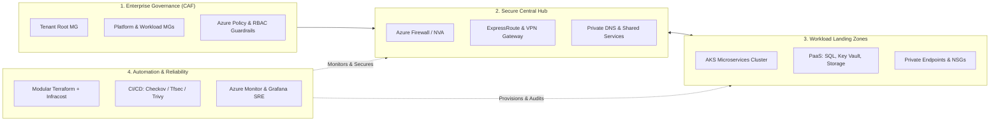

<div align="center">

  <!-- Custom Executive Cloud Architect Banner -->
  <a href="https://linkedin.com/in/ranjan-bhardwaj" target="_blank">
    
  </a>

  <!-- Animated Subtitle -->
  <a href="https://linkedin.com/in/ranjan-bhardwaj">
    
  </a>

  <br/><br/>

  <!-- Quick Action & Status Badges -->
  <a href="https://linkedin.com/in/ranjan-bhardwaj" target="_blank">
    
  </a>
  
  <a href="#-core-architecture-pillars">
    
  </a>
  <a href="https://linkedin.com/in/ranjan-bhardwaj" target="_blank">
    
  </a>

</div>

---

### 🌟 Executive Overview

> **Principal / Lead Cloud Solutions Architect** and infrastructure planning leader with **15+ years** of total IT & telecommunications backbone foundation, including **6+ years** architecting, automating, and securing mission-critical enterprise cloud platforms (Azure-primary, with hands-on AWS).
> 
> Acts as the enterprise **Cloud Subject Matter Expert (SME)** translating C-level business vision into Cloud Adoption Framework (**CAF**)-aligned Landing Zones, multi-subscription governance, modular Infrastructure as Code (**Terraform**), and shift-left **DevSecOps** guardrails.

<div align="center">

| 🏆 Total Experience | ☁️ Cloud Architecture | ⚡ IaC Provisioning Speed | 🚀 Release Velocity | 🛡️ Reliability / SLA |
| :---: | :---: | :---: | :---: | :---: |
| **15+ Years**<br>IT & Network Backbone | **6+ Years**<br>Azure & AWS Architecture | **-60% Reduction**<br>Modular Terraform | **+40% Faster**<br>Automated DevSecOps | **98%+ Sustained**<br>Zero-Downtime HA/DR |

</div>

---

<a id="core-architecture-pillars"></a>
### 🏛️ Core Architectural Pillars

<table>
  <tr>
    <td width="50%" valign="top">
      <h4>🏛️ 1. Enterprise Governance &amp; CAF Landing Zones</h4>
      <ul>
        <li><strong>Tenant &amp; Management Groups</strong>: Designed multi-tier hierarchies under <code>Tenant Root MG</code> (Platform, Workloads, Sandboxes, Decommissioned).</li>
        <li><strong>Subscription Vending</strong>: Automated subscription onboarding &amp; offboarding with strict boundary separation.</li>
        <li><strong>Policy-as-Code</strong>: Enterprise Azure Policy &amp; Initiatives enforcement with formal business-justified exemption workflows.</li>
      </ul>
    </td>
    <td width="50%" valign="top">
      <h4>🌐 2. Hub &amp; Spoke Networking &amp; Zero Trust</h4>
      <ul>
        <li><strong>Centralized Inspection</strong>: Hub VNet hosting Azure Firewall/NVA with <code>UDR (0.0.0.0/0)</code> forcing all spoke traffic through inspection.</li>
        <li><strong>IPAM &amp; CIDR Assessment</strong>: Enterprise IP address space design preventing hybrid &amp; on-premises CIDR overlaps.</li>
        <li><strong>Zero Public Exposure</strong>: Azure Private Endpoints &amp; Private DNS Zones securing PaaS (SQL, Key Vault, Storage).</li>
      </ul>
    </td>
  </tr>
  <tr>
    <td valign="top">
      <h4>⚙️ 3. Production Terraform (IaC) Engineering</h4>
      <ul>
        <li><strong>Hardened Remote State</strong>: Azure Blob storage with encryption at rest, TLS 1.2+, least-privilege RBAC, and lease locking.</li>
        <li><strong>Modular Frameworks</strong>: Versioned, reusable private modules reducing provisioning time by <strong>60%</strong>.</li>
        <li><strong>Cost &amp; Drift Automation</strong>: Pre-deployment <code>Infracost</code> estimates with manual gates &amp; scheduled <strong>Drift Detection</strong> pipelines.</li>
      </ul>
    </td>
    <td valign="top">
      <h4>🛡️ 4. 4-Tier Defense-in-Depth &amp; DevSecOps</h4>
      <ul>
        <li><strong>Multi-Layer Security</strong>: Identity (Entra ID, PIM, MFA), Network (NSG, WAF), Governance (Defender for Cloud), Compute (CMK, hardened images).</li>
        <li><strong>Shift-Left Gates</strong>: Integrated <code>Tfsec</code>, <code>Checkov</code>, and <code>Trivy</code> into CI/CD pipelines to catch vulnerabilities early.</li>
        <li><strong>Branch Policies</strong>: Trunk-based strategy, PR mandatory, minimum reviewers, and Code Owners protection.</li>
      </ul>
    </td>
  </tr>
  <tr>
    <td valign="top">
      <h4>🔄 5. 6R Cloud Migration &amp; Cutover Strategy</h4>
      <ul>
        <li><strong>Full Lifecycle Methodology</strong>: Discovery &amp; Assessment ➔ Landing Zone Readiness ➔ Migration Execution ➔ Cutover ➔ Hypercare.</li>
        <li><strong>Strategy Formulation</strong>: Applying 6R models (Rehost, Replatform, Refactor) based on ROI &amp; dependency mapping.</li>
        <li><strong>Zero Data Loss Cutover</strong>: Rigorous pre/post cutover checklists, DNS switchover, and 24/7 hypercare support.</li>
      </ul>
    </td>
    <td valign="top">
      <h4>💰 6. FinOps &amp; Cloud Cost Governance</h4>
      <ul>
        <li><strong>Waste Elimination</strong>: Automated identification &amp; cleanup of unattached disks, idle load balancers, and orphaned IPs.</li>
        <li><strong>Capacity Planning</strong>: 1-yr / 3-yr Azure Reserved Instances (RI) &amp; Savings Plans optimization.</li>
        <li><strong>Telemetry Tuning</strong>: Log Analytics workspace optimization, filtering high-cost verbose logs, and rightsizing compute.</li>
      </ul>
    </td>
  </tr>
</table>

---

### 📐 Enterprise Architecture Topology



---

### 📂 Architectural Playbooks & Deep Dives

<details>
<summary><b>🏢 Playbook 1: Enterprise Governance, Identity &amp; Tenant Hierarchy</b></summary>
<br/>

* **Microsoft Entra ID (Azure AD)**: Comprehensive user and security group lifecycle management, role-based access control (**RBAC**), least privilege access principles, and Microsoft Defender for Cloud integration.
* **Management Group Hierarchy Architecture**:
  * Designed hierarchical structures beneath **Tenant Root Group**: *Platform MG* (Management, Connectivity, Identity), *Application/Landing Zones MG* (Corp, Online), *Sandbox MG*, and *Decommissioned MG*.
* **Subscription Governance &amp; Boundaries**: Clear separation between platform and workload subscriptions; automated subscription vending, onboarding, and decommissioning workflows.
* **Policy-as-Code &amp; Guardrails**: Enterprise Azure Policy and Policy Initiatives assignments enforcing tags, allowed SKUs, encryption standards, and geographic residency, paired with formal **policy exemption workflows** requiring documented business justifications.

</details>

<details>
<summary><b>🌐 Playbook 2: Hub-and-Spoke Networking Architecture &amp; Zero Trust Perimeter</b></summary>
<br/>

* **Centralized Traffic Inspection &amp; Egress**: Hub VNet architecture hosting centralized Next-Gen Firewalls (Azure Firewall / NVA) with User Defined Routes (**UDR** / `0.0.0.0/0`) forcing all spoke-to-spoke and spoke-to-internet traffic through inspection.
* **IPAM &amp; CIDR Planning**: Enterprise IP address space design and on-premises CIDR assessment to eliminate IP overlap across hybrid and multi-cloud environments.
* **Private Connectivity**: Comprehensive implementation of **Azure Private Endpoints** and **Private DNS Zones**, disabling public exposure for PaaS data stores (Azure SQL, Storage, Key Vault).
* **Hybrid Backbone**: Enterprise-grade interconnectivity leveraging **Azure ExpressRoute** (with redundant circuits) and high-availability site-to-site **VPN Gateways**.

</details>

<details>
<summary><b>⚙️ Playbook 3: Production Terraform Landing Zone Automation &amp; IaC Best Practices</b></summary>
<br/>

* **Hardened Remote State**: State stored in dedicated Azure Blob Storage with encryption at rest, TLS 1.2+ enforcement, strict least-privilege RBAC, and lease-based state locking.
* **Modular Enterprise Framework**: Reusable, parameterized Terraform modules versioned in private registries for networking, compute, identity, and PaaS.
* **Automated Quality &amp; Security Gates**: CI/CD integration of `tflint`, `terraform fmt`, `checkov`, `tfsec`, and secret scanning.
* **Cost &amp; Drift Automation**: Pre-deployment cost estimation via **Infracost** with manual approval gates, plus scheduled unattended pipelines for **Terraform Drift Detection**.

</details>

<details>
<summary><b>🚀 Playbook 4: Azure DevSecOps CI/CD Pipelines &amp; Branching Policies</b></summary>
<br/>

* **Trunk-Based Branching Strategy**: Short-lived feature branches, mandatory Pull Requests (PRs), minimum reviewer enforcement, and **Code Owners** routing.
* **Branch Protection Policies**: `main` branch deletion locks, linear history enforcement, and mandatory build/security check pass criteria.
* **Multi-Stage YAML Pipeline Templates**:
  * `Stage 1: Validate & Test` (Linting, Unit Tests, Static Code Analysis)
  * `Stage 2: Plan & Security Scan` (Tfsec, Checkov, Trivy, Infracost)
  * `Stage 3: Manual Approval Gate` (CAB / Lead Architect sign-off)
  * `Stage 4: Automated Apply` (Isolated service principal deployment)
  * `Stage 5: Rollback & Notification` (Automated failback and telemetry alerting)
* **Middleware &amp; Compute Bootstrapping**: Automated provisioning using VM Custom Data and cloud-init scripts for rapid VM configuration.

</details>

<details>
<summary><b>🔄 Playbook 5: Cloud Migration Lifecycle, Cutover &amp; Hypercare Methodology</b></summary>
<br/>

* **6R Migration Strategies**: Systematic assessment applying *Rehost, Replatform, Refactor, Repurchase, Retain, or Retire* based on workload complexity and business ROI.
* **Phased Migration Journey**:
  * **Phase 1: Discovery & Assessment**: Dependency mapping, network latency profiling, sizing, and TCO/ROI analysis.
  * **Phase 2: Readiness & Landing Zone**: Substrate preparation, connectivity verification, and governance setup.
  * **Phase 3: Migration Execution**: Pre-migration checklists, pilot testing, and data replication.
  * **Phase 4: Cutover & Go-Live**: Strict cutover window execution, DNS repointing, and rollback readiness.
  * **Phase 5: Post-Migration & Hypercare**: 24/7 hypercare support, telemetry validation, and operational handover.

</details>

<details>
<summary><b>💰 Playbook 6: FinOps, Cloud Cost Optimization &amp; Capacity Governance</b></summary>
<br/>

* **Waste Elimination**: Automated discovery and decommission scripts for unattached managed disks, idle load balancers, and orphaned public IPs.
* **Compute Optimization**: Rightsizing oversized compute instances and implementing automated schedule-based VM start/stop routines for non-production environments.
* **Log Ingestion Tuning**: Log Analytics workspace optimization, filtering high-volume verbose tables, and configuring retention policies to curb unnecessary ingestion costs.
* **Capacity Planning**: Formulating strategy for Azure Reserved Virtual Machine Instances (1-yr / 3-yr) and Azure Savings Plans to maximize discount realization.

</details>

<details>
<summary><b>🔄 Playbook 7: High Availability, Backup &amp; Disaster Recovery (HA/DR)</b></summary>
<br/>

* **Storage Resiliency Tiers**: Strategic selection across **LRS**, **ZRS**, and **GRS / RA-GRS** based on data criticality and compliance requirements.
* **Compute High Availability**: Virtual Machine Scale Sets (**VMSS**) with autoscaling, Availability Zones, and cross-region active-passive / active-active topologies.
* **Business Continuity SLAs**: Explicit **RTO** (Recovery Time Objective) and **RPO** (Recovery Point Objective) architecture design, paired with Azure Site Recovery (ASR) failover drills.

</details>

<details>
<summary><b>🤝 Playbook 8: Vendor, Presales &amp; Technical Delivery Governance</b></summary>
<br/>

* **RFP / RFI &amp; Presales Engagement**: Authoring comprehensive technical proposal responses, architecture evaluation matrices, and commercial sizing for enterprise bids.
* **Contractual &amp; SOW Governance**: Defining project scope, deliverables, acceptance criteria, milestone payment sign-offs, sprint backlog dependencies, and risk mitigation registers.
* **Vendor &amp; Third-Party Management**: Environment access provisioning governed by least-privilege principles, vendor escalation matrix design, weekly review cadences, and sprint retrospectives.
* **Transitions &amp; Knowledge Transfer**: Structured documentation handovers, operational runbooks, architecture decision records (ADRs), and formal **RACI matrix** accountability.

</details>

<details>
<summary><b>👥 Playbook 9: Technical Leadership, Team Upskilling &amp; Senior Hiring</b></summary>
<br/>

* **Senior Technical Interviewing**: Lead panelist for hiring Senior/Principal Cloud Architects, DevOps Engineers, and SREs.
* **Knowledge Transfer &amp; Upskilling**: Conducted organization-wide KT sessions on Terraform modularization, Azure CAF, and Kubernetes best practices.

</details>

---

### 🛠️ Technical Ecosystem &amp; Core Stack

<table>
  <tr>
    <td width="25%"><strong>Cloud Platforms</strong></td>
    <td>
      
      
      
      
      
    </td>
  </tr>
  <tr>
    <td><strong>Infrastructure as Code</strong></td>
    <td>
      
      
      
      
      
      
    </td>
  </tr>
  <tr>
    <td><strong>DevSecOps &amp; CI/CD</strong></td>
    <td>
      
      
      
      
      
      
    </td>
  </tr>
  <tr>
    <td><strong>Containers &amp; Platforms</strong></td>
    <td>
      
      
      
      
      
    </td>
  </tr>
  <tr>
    <td><strong>Networking &amp; Security</strong></td>
    <td>
      
      
      
      
      
      
      
    </td>
  </tr>
  <tr>
    <td><strong>Observability &amp; Governance</strong></td>
    <td>
      
      
      
      
      
      
      
    </td>
  </tr>
</table>

---

### 💼 Career History &amp; Core Architectural Milestones

#### **Senior Technical Lead — DevOps &amp; Cloud Architect** | *Colt Technology Services* &nbsp;&nbsp; `Apr 2023 – Present`
* **Enterprise Cloud Strategy &amp; CAF Modernization**: Cloud SME driving multi-cloud strategy, CAF-aligned Landing Zones, and enterprise data modernization roadmaps across Indian and global stakeholders.
* **Tenant &amp; Subscription Hierarchy**: Designed and implemented multi-tier management group architectures (Tenant Root, Platform, Workloads, Sandboxes) with automated subscription vending.
* **Modular Terraform Standardization**: Formulated enterprise-wide reusable Terraform frameworks, establishing remote state hardening, linting, and drift detection pipelines that reduced provisioning times by **60%**.
* **DevSecOps &amp; Shift-Left Implementation**: Embedded security scanners (**Tfsec**, **Checkov**, **Trivy**) into trunk-based Azure DevOps pipelines, accelerating release velocity by **40%**.
* **Client &amp; Presales Engagement**: Partnered with Sales and GTM teams for customer-facing solution architecture in the Indian market, authoring RFP responses, HLD/LLD technical specifications, and driving C-level workshops.
* **AKS &amp; Cloud Native Platforms**: Standardized containerized workloads on AKS using Helm charts, ingress controllers, and secure Key Vault integration.
* **Sustained High Availability &amp; SRE**: Unified telemetry across Azure Monitor, Log Analytics, and Grafana, sustaining **98%+ production uptime**.

#### **Technical Lead — Cloud Architect** | *Colt Technology Services* &nbsp;&nbsp; `Jan 2020 – Apr 2023`
* Led complex cloud migration initiatives, authoring pre/post checklists, cutover procedures, and hypercare plans.
* Engineered hybrid cloud network solutions with ExpressRoute, VPN Gateways, and Azure App Gateway to ensure business continuity.
* Chaired Change Advisory Board (CAB) reviews and release governance meetings, coordinating multi-disciplinary teams.
* Mentored engineers in Terraform IaC, Azure networking, and Kubernetes platform engineering.

#### **Enterprise Telecom &amp; Network Engineering Foundation** &nbsp;&nbsp; `2011 – 2020`
* *SI Infratel | Airtel UNOC | Spectranet*
* 9+ years managing carrier-grade transmission networks, DWDM, SDH, OSPF/EIGRP/VLAN routing, delivering **99.9% network SLA** compliance and 40% faster fault restoration.

---

### 📈 GitHub Activity &amp; Engineering Metrics

<div align="center">
  
  
</div>

<div align="center">
  
</div>

---

### 🤝 What I Bring to Your Organization

```
┌────────────────────────────────────────────────────────────────────────┐
│  ✔ Enterprise Governance, Entra ID & CAF Landing Zone Architecture     │
│  ✔ Scalable Modular Terraform (IaC) with Automated Drift Detection     │
│  ✔ Robust DevSecOps Automation with Shift-Left Security Scanners       │
│  ✔ Zero Trust Hub-and-Spoke Networking & Private Endpoint Topologies   │
│  ✔ 6R Cloud Migration Execution: Discovery, Cutover & Hypercare        │
│  ✔ FinOps Cloud Cost Governance & Capacity Optimization (RI / Savings) │
│  ✔ High-Availability & Disaster Recovery Architectures (98%+ SLA)     │
│  ✔ Client-Facing Presales, RFP/RFI Blueprints & GTM Enablement         │
│  ✔ Vendor SOW Governance, Deliverable Sign-Offs & RACI Accountability  │
│  ✔ Senior Technical Interviews, Team Mentorship & Architectural KT     │
└────────────────────────────────────────────────────────────────────────┘
```

---

### 📬 Connect With Me

Looking for an **Enterprise Cloud Solutions Architect**, a **Principal Cloud Strategist**, or a leader to spearhead your cloud modernization and DevSecOps journey?

<div align="center">

<a href="https://linkedin.com/in/ranjan-bhardwaj" target="_blank">
  
</a>
&nbsp;&nbsp;&nbsp;&nbsp;
<a href="https://github.com/ranjan0404" target="_blank">
  
</a>

<br/><br/>

📍 **Location:** Delhi, India &nbsp;|&nbsp; 🌐 **Open to:** Enterprise Cloud Architecture • Remote & Hybrid Engagements • Leadership Opportunities

</div>

<div align="center">
  
</div>
